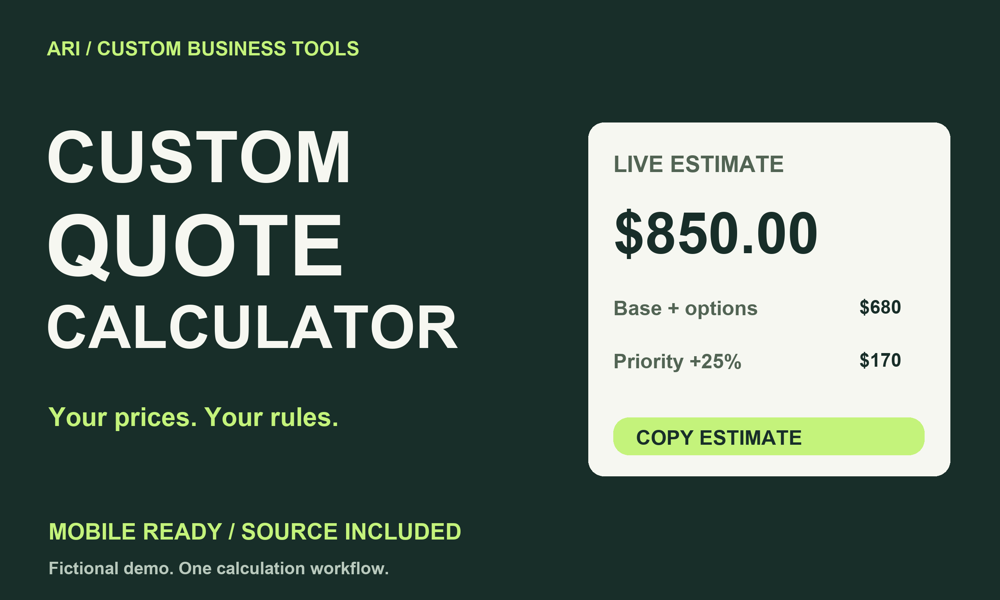
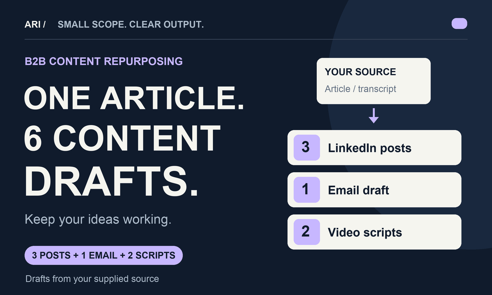

# Small business web tools, files and content

I'm Ari on Fiverr. I offer four fixed-scope pilots for small businesses and creators, with free original examples you can inspect before ordering. AI may assist writing, planning or code; outputs are checked against supplied material.

| Excel / CSV cleanup | Selectable PDF tables → Excel |
| --- | --- |
|  |  |
| **$20 · 2 days · 1 revision** | **$20 · 2 days · 1 revision** |
| One flat sheet, up to 100 data rows and 10 columns. Agreed cleanup rules, preserved source and change log. | One selectable-text PDF, up to 5 pages, 500 table rows and 10 columns. XLSX/CSV plus source notes. |
| [See service & order on Fiverr](https://www.fiverr.com/fghjhbcv/clean-and-organize-excel-csv-data-with-a-documented-change-log) · [Free before/after example](https://github.com/didyouseethis212-sys/small-data-cleanup-examples) | [Send a sample / see service on Fiverr](https://www.fiverr.com/fghjhbcv/convert-selectable-pdf-tables-to-excel-or-csv-with-source-checks) · [Free PDF and workbook](https://github.com/didyouseethis212-sys/small-data-cleanup-examples) |

| Custom quote calculator | B2B content repurposing |
| --- | --- |
|  |  |
| **$120 · 5 days · 1 revision** | **$50 · 3 days · 1 revision** |
| One responsive page, one calculation workflow and up to 8 inputs. Your pricing rules, live breakdown, source code and setup guide. | From your English article/transcript up to 2,000 words: 3 LinkedIn posts, 1 email and 2 short-video scripts, up to 1,000 delivered words total. |
| [See service & order on Fiverr](https://www.fiverr.com/fghjhbcv/build-a-custom-quote-calculator-for-your-small-business) · [Free calculator source](quote-demo/index.html) | [See service & order on Fiverr](https://www.fiverr.com/fghjhbcv/repurpose-b2b-content-into-linkedin-posts-emails-and-video-scripts) · [Free content sample](https://github.com/didyouseethis212-sys/b2b-content-repurposing-kit) |

## Choose the right pilot

- Messy rows or duplicate records? Start with **Excel/CSV cleanup** and explain what makes a duplicate.
- A table trapped inside a selectable-text PDF? Send a **de-identified PDF sample on Fiverr** first so I can confirm extractability.
- Repeating the same pricing calculation? Try the **custom quote calculator**. Includes a browser-local sample; excludes login, payments, databases, hosting and native apps.
- An existing article that should become multiple written assets? Choose **B2B repurposing**.

These are deliverable services, not software subscriptions. Content packages cover writing, not posting, video production or channel management. Data packages exclude scans/handwriting, macros, complex merged layouts and unapproved guesses. See each Gig for the complete scope.

## Try the free quote calculator

Download the files in [quote-demo](quote-demo), keep them together, and open `index.html` in a browser. It is an original fictional design-studio example, not a client result. No API key, signup or payment is required. For clipboard copying use HTTPS or localhost; browser printing is the fallback. The example does not create bookings or collect payments.

Test case: 10 presentation slides ($250), copy polish ($400), source files ($30), then a 25% priority surcharge ($170) = **$850**. These are fictional demonstration prices, not the fee for my development service.

If you want your own pricing rules and branding, [message me on Fiverr](https://www.fiverr.com/s/ae7Pj08) with your formula and three expected results. The fixed pilot is **$120 / 5 days / one revision**, up to 8 inputs and one calculation workflow.

## Free script-audit example (educational archive)

The fictional desk-kit example includes supplied facts, a draft and a lightweight structural checker:

```sh
python3 audit_script.py script-source.json script-delivery.json
```

It checks word limits, title count and source-ID existence. **It does not verify that a claim is true or that a source supports it.** Review each claim and every implied promise manually. The example files are fictional, original demonstrations, not paid client results. No API key or network request is required.

## Start safely

Tell me your goal, chosen service and input type in the [Fiverr inbox](https://www.fiverr.com/fghjhbcv). Provide only authorized material with personal and confidential information removed. No account credentials are needed. All communication, orders, payment and delivery stay on Fiverr. No views, rankings, sales or revenue are guaranteed.

Disclosure: I operate the linked Fiverr services. You may inspect and use the free examples without purchasing. AI helped create this page and the examples.
